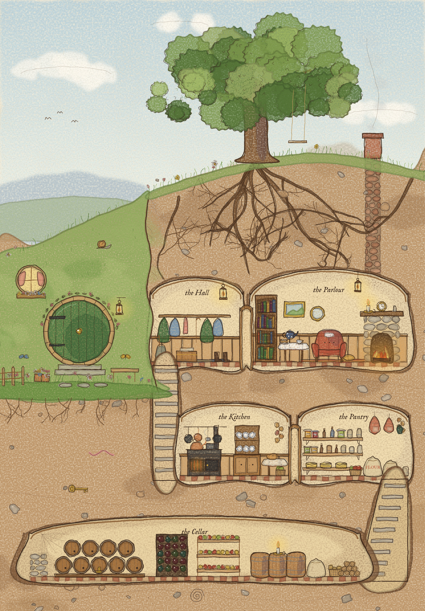
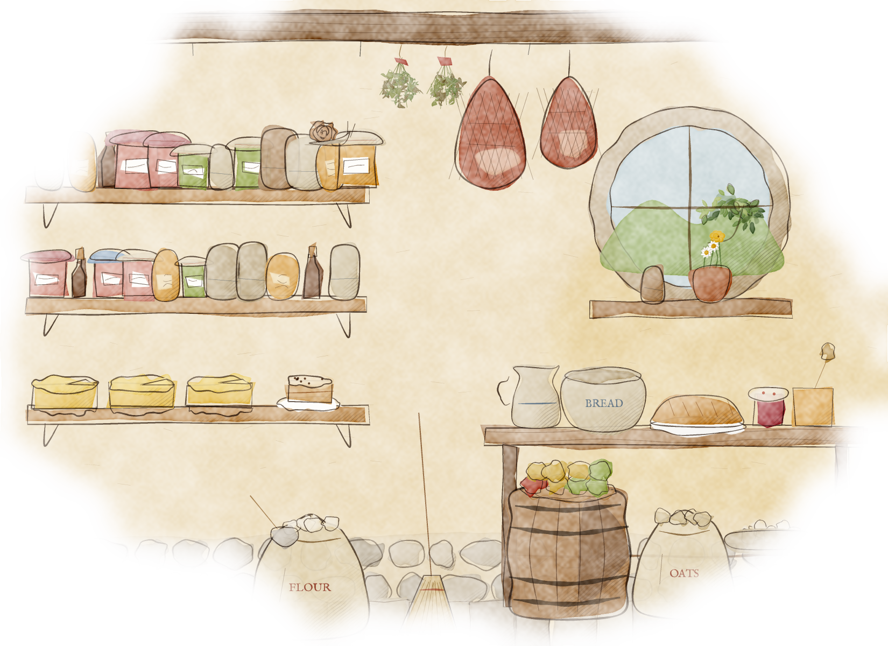
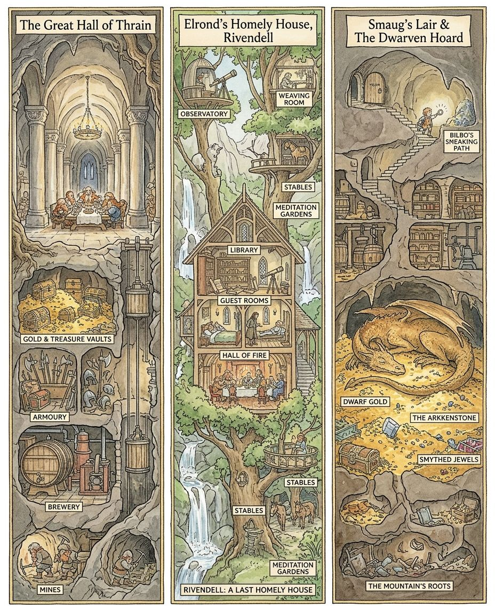

# 7 · The “Hedgerow Cutaway” style: prompt library for AI image generators

A portable source of truth for the edition's illustration style. Feed it to any image generator, or to an assistant that writes prompts for one, together with the anchor images, and the results should look like they came from one illustrator.

The style is inspired by classic English hedgerow picture books with their dollhouse cutaways. **No artist's name or book-series title appears in any prompt in this library, and none should be added.** Many generators refuse such prompts. Copying a named artist's style for a commercial book is also the clearest legal and ethical risk in the project (rights doc §1.1, art bible §2.10). The style is described entirely by its visible qualities.

## 7.0 Quick start

1. **Pick a scene template** (§7.6), or write your own scene sentence.
2. **Add the Master Style Block** (§7.5): the long version for most models, the short version for prompt-limited ones.
3. **Attach 1–3 anchor images** (§7.7) as style references, and say how to use them: "Match the drawing and painting style of the attached reference images. Use them for style only, not for content."
4. **Add the "Avoid" line** (§7.5), or the model's negative-prompt field.
5. **Score the result** with the checklist (§7.8). Keep the best results and promote them to anchors.

---

## 7.1 Pillar 1: Composition and perspective

**Core principles**

- **The blueprint view.** Show every room and level at once, as if the front wall had been sliced away. The view is side-on and nearly flat, like an architect's section drawing or an open dollhouse. Avoid steep perspective and avoid looking down from above.
- **Logical flow.** Every space is functional and connected. Staircases, ladders, chimneys, flues, pipes, hatches and tunnels show how you would walk, carry or climb from room to room. A child should be able to trace a route with a finger.
- **Readable structure.** Use a clear ground line. Put rooms on two to four stacked levels, with arched or rounded ceilings and a visible thickness of earth, stone or timber between them. The cut face of the earth is part of the picture.
- **Framing.** On a full page the outside world shares the frame: sky, hill, tree, path, garden. Use the left or upper third for the outside and the rest for the cutaway.

**Prompt block**

```text
A detailed, dollhouse-style cross-section cutaway seen from the side, like an architect's section drawing: the front wall is sliced away to reveal several stacked levels of small rooms at once. Staircases, ladders, chimneys, flues, pipes and tunnels connect every room in a practical, logical way so you can trace a route through the whole building. A clear ground line, rounded arched ceilings, and a visible thickness of earth, stone or timber between the levels; the outside world (sky, hill, tree, path) shares the frame.
```

## 7.2 Pillar 2: Texture and medium

**Core principles**

- **Hand-drawn line.** Fine, delicate outlines on every element: slightly irregular, soft and friendly, never ruler-straight or geometric. **Warm sepia-brown ink** is the house default. For a crisper look, swap in "black ink".
- **Traditional media.** Soft, transparent watercolour washes, layered so colours deepen where they overlap. Pigment pools a little at the edges of washes. Light coloured-pencil shading and gentle cross-hatching on shadow sides. Visible cream cold-press paper, with white paper left for highlights.
- **Palette.** Warm, earthy and inviting:

  | Colour | Hex |
  |---|---|
  | honey | `#dcae3e` |
  | ochre | `#dba94f` |
  | russet | `#b9553d` |
  | moss | `#7f9c4d` |
  | sage | `#93b062` |
  | bramble purple | `#6e3456` |
  | dog-rose pink | `#dc8e7c` |
  | soft sky blue | `#b9d2dc` |
  | golden earth | `#d3b07e` |
  | cream paper | `#f6eedb` |

  Shadows are cool violet-grey, never black.
- **Light.** Golden lamplight and firelight inside, soft morning or evening daylight outside, and gentle glows around lanterns and hearths.

**Prompt block**

```text
A whimsical classic children's book illustration in traditional media. Every element has delicate, slightly irregular hand-drawn outlines in warm sepia-brown ink, soft and friendly, never geometric. Colour is soft, transparent watercolour washes layered so they deepen where they overlap, with pigment pooling slightly at the wash edges, light coloured-pencil shading and gentle fine cross-hatching on the shadow sides. Visible cream cold-press paper texture, with white paper left for highlights. A warm, earthy, inviting palette of honey, ochre, russet, moss and sage green, bramble purple, dog-rose pink and soft sky blue; cool violet-grey shadows; golden lamplight inside and soft daylight outside.
```

## 7.3 Pillar 3: Density of clutter and integration with nature

This is the pillar that makes the style. **Nothing is clean or sparse.** Every room is crowded with useful, well-loved things, and every corner has a small story.

**Core principles**

- **Cosy functionalism.** Pack each room with dozens of items that belong to its purpose (see the inventories below). Repeat small objects in rows on shelves, hooks and racks: jars, crocks, baskets, sacks, bunches, coils.
- **Micro-storytelling.** Add small, specific signs of life: a half-eaten slice of cake, a kettle steaming, knitting left on a chair, a cobweb in a cellar corner, boots drying by the door, a ladder left against shelves. **The house motif is a tiny brown snail hidden in every large picture.**
  - Optional extras: an ordinary field mouse (undressed and natural, not a character) and an *unlit* clay pipe on a rack.
- **Nature integration.** Building and nature are inseparable:
  - Earth, stones and great tree roots form and wrap the walls, and the cut earth shows pebbles, root-hairs, a worm or a buried key.
  - Outside, add winding paths, wildflowers (daisies, foxgloves, buttercups, clover, campion, forget-me-nots), ferns, brambles with blackberries, dog-roses, ivy and mushrooms.

**Room inventories** (pick 6–10 nouns per room, and name them in the prompt):

| Room | Contents |
|---|---|
| **Hall** | coat pegs with cloaks and hats, umbrella and walking-stick stand, boots, rag-rug runner, wooden chest, barometer, lantern, round mirror |
| **Parlour** | bookcase, wing armchair with patchwork cushion, tea table with gingham cloth, teapot and cups, cake on a stand, stone fireplace with a fire and a pot on a crane, mantel clock and candlesticks, framed pictures, knitting basket, rag rug, drying herbs |
| **Kitchen** | cast-iron range, copper kettle, row of hanging copper pans, dresser of blue-and-white plates and jugs, scrubbed table with bread and a jug of flowers, strings of onions, flour bin, broom, basket of vegetables |
| **Pantry / larder** | shelves of jam, honey and pickle jars with gingham cloth lids, wheels of cheese, netted hams, eggs in a bowl, crocks, sacks of flour and oats with a scoop, baskets of apples and potatoes, bunches of herbs |
| **Cellar** | barrels on racks with taps and painted names, wine rack, slatted apple racks, potato sacks, firewood stack, candle lantern, cobweb |
| **Bedroom** | patchwork quilt, round window with curtains, washstand with jug and bowl, chest of drawers, slippers, candlestick |
| **Study** | writing desk with quill, ink and papers, maps pinned to the wall, globe, shelves of books, a sword over the mantel |
| **Workshop / mill** | workbench, hanging saws and chisels, wood shavings, gear wheels, belts and pulleys, a millstone, sacks of grain |
| **Tree storehouse** | spiral stair carved inside the trunk, rope-and-pulley basket lift, lofts of nuts, apples and honey, wooden ladders, knot-hole windows |

**Prompt block**

```text
The scene is defined by cosy functionalism and abundant clutter: every room is crowded with dozens of useful, well-loved everyday things that belong to its purpose, arranged in rows on shelves, hooks and racks: jars and crocks with cloth lids, baskets, sacks, tools, crockery, hanging herbs and hams. Tiny lived-in details tell small stories: a steaming kettle, a half-eaten cake, knitting left on a chair, boots drying by the door, a cobweb in a corner, and a tiny brown snail hidden somewhere. The architecture is organic: earth, stones and great tree roots form and wrap the walls, the cut earth shows pebbles and root-hairs, and outside there are winding paths, wildflowers, ferns, brambles with blackberries, dog-roses and wild mushrooms, keeping a gentle pastoral feel.
```

## 7.4 Pillar 4: Labels and functional text

Labels are part of the picture's function: they name the rooms so a child can explore the plan. **Image models still misspell text often**, so there are two routes.

**Option A (recommended for print): blank labels, real type added later.** Ask for empty parchment ribbons or tags pointing at each area. Then set the words in the layout (Krita, Affinity, Canva or the book build), in the font you choose. The spelling is always right, and the labels can be translated or changed without repainting.

```text
Each main room has a small blank parchment ribbon or tag with a fine curved pointer line leading into it, placed in clear wall or earth space where it does not cover any detail. Leave every ribbon completely empty, with no letters.
```

**Option B: labels drawn by the model.** Keep them few (four to six), short and in capitals. Generators known for good lettering (for example Ideogram, Recraft or the newest Gemini and GPT image models) do this best. Proofread every letter.

```text
The illustration includes a few precise, stylised labels on small parchment ribbons, each with a fine arrow pointing clearly to its room: 'THE HALL', 'THE PARLOUR', 'THE KITCHEN', 'PANTRY & LARDER', 'THE CELLAR'. All labels use one clean, simple, accessible sans-serif font in dark sepia, small and evenly spaced, acting as technical annotation on the cross-section. No other text anywhere.
```

**Label vocabulary:** THE HALL · THE PARLOUR · THE KITCHEN · PANTRY & LARDER · THE CELLAR · BEDROOM · THE STUDY · STOREROOM · APPLE LOFT · WINE CELLAR · WORKSHOP · THE GREAT WINCH · WATER-GATE

**Typography note:** the book's text uses classic old-style type (EB Garamond and IM Fell). A clean sans-serif gives labels a "technical annotation" feel. If it looks too modern next to the watercolour, use a soft humanist sans or a small italic serif instead.

## 7.5 The Master Style Block and the Avoid line

Paste these after your scene description.

**Master Style Block (long):**

```text
Style: a classic children's picture-book illustration in a detailed hedgerow-cutaway style. Dollhouse-style side-on cross-section with the front wall sliced away, showing several stacked levels of small rooms at once, all connected by staircases, ladders, chimneys and tunnels in a practical, logical way. Fine, delicate, slightly irregular hand-drawn outlines in warm sepia-brown ink, never geometric; soft transparent watercolour washes layered with light coloured-pencil shading and gentle cross-hatching in the shadows; visible cream cold-press paper with white paper left for highlights. Warm, earthy, inviting palette of honey, ochre, russet, moss and sage green, bramble purple, dog-rose pink and soft sky blue, with golden lamplight inside and soft daylight outside. Every room is crowded with useful, well-loved everyday things and tiny lived-in details to discover; earth, stones and great tree roots form the walls, surrounded by winding paths, wildflowers, ferns, brambles and mushrooms. Gentle, cosy, safe and full of wonder.
```

**Master Style Block (short, for prompt-limited models):**

```text
classic children's book illustration, dollhouse cross-section cutaway, many small connected rooms on several levels, delicate sepia ink linework, soft transparent watercolour and coloured pencil, cream paper texture, warm earthy palette, golden lamplight, crowded cosy clutter, tree roots and earth walls, wildflowers and mushrooms, gentle and whimsical
```

**Avoid line** (use the model's negative-prompt field where it has one):

```text
Avoid: photorealism, 3D render, CGI, glossy digital painting, airbrushed gradients, vector or flat design, cel shading, anime or manga style, heavy black outlines, neon or oversaturated colour, empty or sparse rooms, modern objects (plastic, electric lights, machines with screens), misspelled or random text, watermarks, signatures, frames, scary faces, gore. Do not imitate any specific living or dead artist, book series, film or game.
```

## 7.6 Scene templates

Fill in the [brackets], then add the Master Style Block and the Avoid line.

**T1. Full-page burrow-home cutaway** (portrait, 2:3)

```text
A tall portrait full-page illustration: a cutaway of a cosy burrow-home dug into a grassy hill [in SEASON, at TIME OF DAY]. Outside on the left, a round green door with a brass knob in the middle, roses climbing around it, a round window with a flower box, a lantern and a bench. The hill is cut away to show [HALL, PARLOUR, KITCHEN, PANTRY, CELLAR] on three levels in golden earth threaded with tree roots, linked by stairs and a chimney flue. A big oak with a rope swing grows on top.
```

**T2. Tree storehouse cutaway** (portrait, 2:3)

```text
A tall portrait full-page illustration: a cutaway of an ancient hollow oak used as a storehouse, with a spiral stair carved inside the trunk, a rope-and-pulley basket lift, lofts of [nuts / apples / honey / grain], knot-hole windows, and roots below holding a root-cellar of jars and barrels. Hedgerow flowers, brambles and mushrooms around the base.
```

**T3. Mechanism cutaway** (portrait or landscape)

```text
A cutaway illustration of [a vaulted barrel cellar over an underground river / a water-mill / a winch-house]: plausible, meshing gear wheels, a crank, ropes over pulleys, a counterweighted lever and a trapdoor, with barrels being lowered and floating away through an arched water-gate. Every mechanism should look as if it could really work.
```

**T4. Waterside or stilt-town cutaway** (landscape, 3:2)

```text
A wide landscape illustration: a wooden town on stilts over a misty lake at dusk, with some houses cut away to show storerooms and ladders, boats moored beneath walkways, a wooden crane hoisting barrels, lanterns in windows, and a single mountain on the far horizon.
```

**T5. Close-up spot illustration** (landscape, 4:3, soft vignette)

```text
A landscape spot illustration with soft edges fading into the cream page: a close-up corner of [a pantry / a kitchen dresser / a workshop bench / a bedroom], crowded with [6-10 named items from the room inventories], with a deep-set round window letting in daylight.
```

**T6. Chapter-opener roundel** (wide banner, 11:4)

```text
A decorative chapter-opening banner: a cream roundel framed by a ring of tiny berries, containing a small still-life of [EMBLEM OBJECT], with curving bramble branches, leaves, dog-roses and blackberries extending left and right. Plain background, no text.
```

**T7. Margin nature study** (small, square)

```text
A small natural-history study on plain cream paper with no background: [a bumblebee on bramble flowers / a banded snail / acorns and oak leaves / wild strawberries / a dragonfly], delicate and botanically accurate, like a page from an old naturalist's sketchbook, lots of white paper showing. No text, no border.
```

**T8. Dramatic but child-safe plate** (portrait, 2:3)

```text
A tall portrait full-page illustration: [SCENE, e.g. a vast red-gold dragon curled asleep on a hoard of treasure in a dim stone hall]. Awe-inspiring but never frightening: soft shapes, warm light against cool shadow, no gore, nothing menacing in the faces.
```

**Worked example** (T1 + long block + Avoid line, ready to paste):

```text
A tall portrait full-page illustration: a cutaway of a cosy burrow-home dug into a grassy hill on a summer evening. Outside on the left, a round green door with a brass knob in the middle, roses climbing around it, a round window with a flower box, a lantern and a bench. The hill is cut away to show a hall, a parlour, a kitchen, a pantry and a long cellar on three levels in golden earth threaded with tree roots, linked by stairs and a chimney flue. A big oak with a rope swing grows on top. Style: a classic children's picture-book illustration in a detailed hedgerow-cutaway style. Dollhouse-style side-on cross-section with the front wall sliced away, showing several stacked levels of small rooms at once, all connected by staircases, ladders, chimneys and tunnels in a practical, logical way. Fine, delicate, slightly irregular hand-drawn outlines in warm sepia-brown ink, never geometric; soft transparent watercolour washes layered with light coloured-pencil shading and gentle cross-hatching in the shadows; visible cream cold-press paper with white paper left for highlights. Warm, earthy, inviting palette of honey, ochre, russet, moss and sage green, bramble purple, dog-rose pink and soft sky blue, with golden lamplight inside and soft daylight outside. Every room is crowded with useful, well-loved everyday things and tiny lived-in details to discover; earth, stones and great tree roots form the walls, surrounded by winding paths, wildflowers, ferns, brambles and mushrooms. Gentle, cosy, safe and full of wonder. Avoid: photorealism, 3D render, CGI, glossy digital painting, vector or flat design, anime style, heavy black outlines, neon colour, empty rooms, modern objects, random text, watermarks, signatures, frames, scary faces. Do not imitate any specific living or dead artist, book series, film or game.
```

## 7.7 Anchor images

Attach these as style references. They are in `output/style-anchors/` (resized for uploading), with a single combined sheet for tools that accept only one image.

| Anchor | File | Teaches the model |
|---|---|---|
| **A1. Composition** | `A1_composition_burrow_cutaway.jpg` | Pillar 1: side-on cutaway, stacked connected rooms, roots and earth, outside world in frame |
| **A2. Mechanism** | `A2_mechanism_cellar.jpg` | Pillar 1 + 3: plausible winches, gears, trapdoor, water-gate |
| **A3. Medium and clutter** | `A3_medium_pantry_closeup.jpg` | Pillars 2 + 3: line weight, washes, paper, crowded shelves, soft vignette |
| **A4. Nature studies** | `A4_nature_studies_sheet.jpg` | Pillar 3: botanically accurate small studies, white paper |
| **A5. Decoration** | `A5_decoration_opener.jpg` | Ornament: bramble banner, roundel, berries |
| **All** | `A0_anchor_sheet.jpg` | Everything at once, for single-image tools |
| **U1. Your reference: ink & wash panels** | `U1_three_panel_cutaways.jpg` | Style variant B (§7.9): crisp hatched ink, muted stone and gold palette, vertical panel layout, boxed labels |







**How to attach them, by tool** (interfaces change, so check each tool's current help):

| Tool | How |
|---|---|
| **Gemini (app or API)** | Attach the anchors, then add: "Match the drawing and painting style of the attached reference images; use them for style only." To refine a layout, attach that layout first and say "repaint this composition". |
| **ChatGPT / GPT image models** | Attach the anchors with the same sentence. Ask for portrait or landscape explicitly. |
| **Midjourney** | Upload the anchors and use them as style references (`--sref`), with `--ar 2:3` for a full page and `--ar 3:2` for a spread. Use `--no` for the Avoid items. |
| **Local SDXL / Flux (ComfyUI, Krita AI)** | Use the anchors through a style or IP-adapter reference, the layout through ControlNet (`tools/local_refine.py`), and the Avoid line as the negative prompt. |
| **Gemini API from this project** | `tools/ai_refine.py` builds these prompts automatically from the art bible and the plan. |

**Grow a golden set.** These anchors are code-painted style studies. When a generated or hand-painted image scores well on §7.8, add it to the anchors and retire a weaker one. After a few rounds the anchors become *your* style, and every new image is pulled towards it.

## 7.8 Consistency checklist

Score each image from 1 to 5. Keep images that average 4 or more; repaint or regenerate the rest.

| Pillar | Score 5 looks like… | Common failures |
|---|---|---|
| **1. Composition** | Side-on section; several connected levels; you can trace a route | Steep perspective, rooms floating unconnected, cutaway "wall" missing |
| **2. Medium** | Fine sepia lines, transparent washes, paper texture, cool shadows | Glossy digital look, heavy outlines, saturated colour, smooth airbrushing |
| **3. Clutter and nature** | Dozens of nameable objects per room; roots, flowers, mushrooms; the snail | Empty walls, generic blobs, modern objects, no nature at the edges |
| **4. Labels** | Blank ribbons (option A) or correctly spelled short labels (option B) | Gibberish letters, labels covering detail |
| **Safety** | Gentle, child-friendly, no look-alike of films or other illustrators | Scary faces, film-style designs, an artist's signature style copied too closely |

## 7.9 Style variant B: ink & wash (from your reference U1)

> **Provenance:** U1 was made in the Gemini app with a prompt that named a specific book series (see `art/anchors/SOURCES.md`). Use it for the *qualities* listed below only. Never reuse that prompt. Replace U1 with a neutrally prompted image as soon as one scores well.

Reference U1 shows a crisper sibling of the house style, closer to a finely hatched pen drawing tinted with watercolour. Choose **one** family per book and do not mix their anchors in a single prompt, or the model will average them:

- **Variant A (soft watercolour):** anchors A1–A5 and the Master Style Block.
- **Variant B (ink & wash):** anchor U1 and the blocks below.

**What U1 does well (keep):**

- Confident dark-brown ink with dense hatching that models every form.
- Muted stone grey, moss, wood-brown and treasure-gold palette, with gentle but strong light and shade.
- Rooms crowded with objects that read clearly at small size.
- Deep vertical sections from the surface to the roots.
- Tall framed panels with a parchment title cartouche.
- Labels in small white boxes with a thin dark border and clean sans-serif capitals.
- A dragon with four legs and separate wings, as in the book.

**What U1 gets wrong (do not copy):**

- Misspelled labels ("SMEAKING", "ARKKENSTONE", "SMYTHED"). Use blank boxes and add the text later (§7.4 option A), or proofread every letter.
- Duplicated labels ("STABLES" three times).
- Places that contradict the book: the elf-lord's house is not a treehouse, and there are no stables in trees.
- At 928 × 1144 px it is a style reference only. Print needs about 2100 × 3100 px for a full page.

**Medium block, variant B** (use in place of Pillar 2):

```text
Precise, confident dark sepia-brown ink linework with dense fine hatching and cross-hatching that models every form, like a detailed pen drawing tinted with transparent watercolour. Muted stone greys, moss and sage greens, warm wood browns and glowing treasure golds, with strong but gentle light-and-shade contrast and warm lantern glow; crisp, readable detail at small scale; cream paper.
```

**Label block, variant B** (matches U1's boxes):

```text
Small white rectangular label boxes with a thin dark border, each pointing at its area, containing short labels in clean sans-serif capitals. [List the exact words, e.g. 'THE CELLAR', 'PANTRY & LARDER'.] Spell every word exactly as given; no other text. (Or: leave every label box empty.)
```

**T9. Three-panel vertical cutaway** (portrait, for endpapers, posters, chapter maps or a "places of the story" spread):

```text
Three tall, narrow vertical cutaway panels side by side, each framed by a thin ornamental border with a parchment title cartouche at the top: [PANEL 1 e.g. a great dwarf hall with vaults, armoury, brewery and mines below], [PANEL 2], [PANEL 3]. Each panel is a deep cross-section from the surface down through several levels, connected by stairs, shafts, rope lifts and tunnels, every chamber crowded with appropriate objects. Each place must match the story's description; do not invent rooms that contradict it.
```

**Worked example, variant B** (recreates U1's look with neutral wording; paste as is):

```text
Three tall, narrow vertical cutaway panels side by side, each framed by a thin ornamental border with a parchment title cartouche at the top (leave the cartouches empty). Panel 1: a great dwarf hall carved in stone with pillars and a long feasting table, and below it, connected by a rope lift and a stone stair, treasure vaults, an armoury, a brewery with copper vats and barrels, and mine tunnels at the bottom. Panel 2: a large timber-and-stone house in a deep green valley beside waterfalls, cut away to show a library, guest bedrooms, a hall of fire with a long table, and stables and gardens at ground level. Panel 3: a vast cave under a mountain with a secret door and a winding stair at the top, storerooms of barrels and shelves partway down, a red-gold dragon with four legs and folded wings asleep on a hoard of gold, goblets and jewels, and the mountain's roots and tunnels below. Every chamber is crowded with appropriate objects; small figures appear only tiny and in the distance. Small white rectangular label boxes with a thin dark border point to the main areas; leave every label box empty. Precise, confident dark sepia-brown ink linework with dense fine hatching and cross-hatching that models every form, like a detailed pen drawing tinted with transparent watercolour; muted stone greys, moss and sage greens, warm wood browns and glowing treasure golds, with strong but gentle light-and-shade and warm lantern glow; crisp, readable detail; cream paper. Gentle and child-friendly. Do not imitate any specific living or dead artist, book series, film or game. No photorealism, no 3D render, no glossy digital painting, no text anywhere.
```

## 7.10 Rules that always apply

- **Never put an artist's name, a book-series title or a film title in a prompt.**
- Design the book's characters yourself first (art bible §2.6). Give generators *your* character sheets as references, never film stills.
- Record every generated image, with tool, prompt and date (`art/ai/log.csv` does this for the project tools), and disclose AI content where platforms require it (rights doc §1.7).
- Paint over by hand before publication. It improves quality, and it makes the illustrations more clearly your own.
